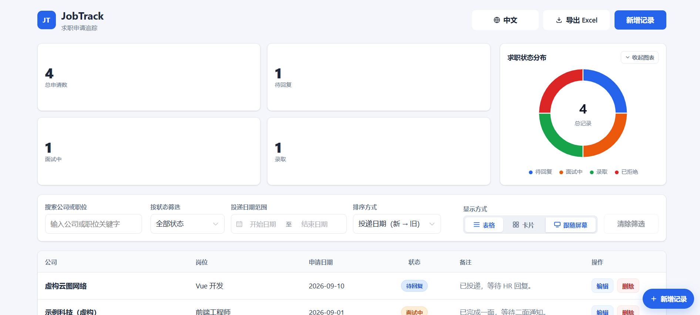

# JobTrack

一个轻量级的求职申请追踪应用：集中管理投递过的公司、职位、日期、状态与备注，提供组合筛选、统计图表、Excel 导出与删除撤销，帮助你在求职过程中随时掌握整体进展。

前端为 Vue 3 + TypeScript + Vite，后端为 Express 5 + SQLite（better-sqlite3）。所有数据保存在本机，不上传到任何服务器，适合作为个人求职记录工具，也可作为前后端分离开发的参考项目。


## 界面截图



## 核心功能

- 职位记录管理：新增、编辑、删除（含表单校验与删除二次确认）
- 组合筛选与排序：关键词（公司/职位，不区分大小写）、状态、投递日期范围、按投递日期升序/降序，可叠加使用
- 顶部统计卡片：总申请数、待回复、面试中、录取（始终基于全部记录）
- 求职状态分布环形图（ECharts）：四种状态的数量与占比；窄屏默认收起，可随时展开
- 职位详情抽屉：点击记录查看完整字段与备注
- 删除撤销：删除后 5 秒内可撤销，按原排序位置恢复（连续多次操作按后进先出逐条撤销）；新增同样可撤销
- Excel 导出（.xlsx）：支持「全部记录」或「当前筛选结果」，文件在浏览器本地生成
- 中英文界面：默认简体中文，首次访问按浏览器语言自动选择，可随时切换
- 表格 / 卡片双视图：默认按屏幕宽度自动选择（≤1020px 卡片），可手动切换并记住偏好
- 悬浮「新增记录」按钮：浏览长列表时无需回到顶部
- 响应式布局，适配手机与桌面

## 技术实现亮点

- **后端是唯一数据源**：职位记录持久化于 SQLite（WAL 模式），刷新与重启后均保留；页面加载失败时给出明确错误与重试入口，不会用本地旧数据顶替
- **稳定排序模型**：每条记录携带持久化 `sort_order`，由「高水位计数器」在写事务内分配，删除不压缩顺序；删除返回完整快照，撤销按原槽位恢复，冲突时 409 拒绝覆盖
- **可靠的撤销体验**：前端 5 秒 LIFO 撤销栈；网络失败或结果不确定时明确提示「待确认」，绝不误报成功，必要时向服务器核对真实状态
- **旧数据平滑迁移**：自动检测旧版本 localStorage 数据，幂等导入 + 逐条对账后才写迁移标记，失败不破坏原始数据
- **纯前端 Excel 导出**：`exceljs` 按需动态加载，所有单元格写入纯文本（防止公式注入），数据不出浏览器
- **统一 API 契约**：成功 `{ data }` / 失败 `{ error: { code, message } }`，前后端共享同一套状态码语义

## 环境要求

- Node.js ≥ 22.5（后端 better-sqlite3 的要求；推荐 24 LTS，见 `server/.nvmrc`）
- npm（随 Node 安装）
- 运行 E2E 测试需本机安装 Chrome 或 Edge

## 快速开始

```bash
# 1. 安装依赖（项目根目录执行）
npm install
npm install --prefix server        # 后端依赖；better-sqlite3 使用预编译二进制，无需本地编译

# 2. 启动后端 API（终端 1，项目根目录执行）
npm run server:dev                 # tsx watch，监听 http://127.0.0.1:4000

# 3. 启动前端（终端 2，项目根目录执行）
npm run dev                        # Vite 开发服务器，http://localhost:5173
```

启动后访问 **http://localhost:5173**。前端通过 Vite 代理将 `/api` 请求转发到 4000 端口，因此必须先启动后端；后端就绪可通过健康检查确认：`GET http://127.0.0.1:4000/api/health`。

数据库在首次启动时自动创建并初始化（无需手动建表），无需其他初始化步骤。

构建与生产运行：

```bash
npm run build                      # 前端类型检查 + 生产构建（输出 dist/）
npm run preview                    # 本地预览生产构建
npm run server:build               # 后端编译到 server/dist
npm run server:start               # 生产模式启动后端（可用 PORT/HOST 环境变量覆盖）
```

## 测试

```bash
npm run server:test                # 后端 vitest 单元与集成测试

npx playwright test                # 浏览器 E2E（Chrome / Edge 双引擎）
# 前置：先按"快速开始"启动前后端两个开发服务器

node server/node_modules/tsx/dist/cli.mjs tests/frontend/p2d1.integration.mjs
# 前端接入集成测试（纯 Node 环境，不经浏览器）
# 前置：npm run server:build 已产出 server/dist/server.js
```

测试均使用独立临时数据库（`JOBTRACK_DATA_DIR`），不会触碰真实数据。

## 项目结构

```
├── index.html                  # 入口页面
├── src/                        # Vue 3 前端
│   ├── api/                    # API 客户端、旧数据迁移
│   ├── components/             # StatsBar / StatusChart / SearchFilter / ExportButton
│   │                           # JobForm / JobTable / JobDetailDrawer / AppToast
│   ├── composables/            # useJobs / useUndoStack / useViewMode / useI18n 等
│   ├── utils/                  # Excel 导出、日期范围映射
│   └── types.ts                # 领域类型与状态定义
├── tests/
│   ├── browser/                # Playwright E2E 用例
│   └── frontend/               # Node 环境集成测试
├── server/                     # Express 5 + better-sqlite3 后端
│   ├── src/                    # routes / services / repositories / middleware / db
│   ├── tests/                  # vitest 测试与冒烟脚本
│   └── docs/                   # 后端存储与撤销恢复设计说明
├── vite.config.ts              # 含 /api 代理与 vitest 配置
└── playwright.config.ts
```

## 数据存储与注意事项

- 职位记录保存在 **`server/data/jobs.db`**（SQLite，WAL 模式）。数据目录自动创建，可用环境变量 `JOBTRACK_DATA_DIR` 更改位置；数据库文件已被 `.gitignore` 排除，不会提交
- 无需手动初始化数据库：首次启动自动建表；旧版本数据库自动迁移，不删除、不清空任何记录
- 浏览器 localStorage 只保存界面语言、视图偏好和迁移标记，不保存职位数据
- 所有数据仅存在于本机：API 只在本地进程间通信，Excel 导出在浏览器内完成，项目不包含任何数据上传
- 撤销栈只存在于内存，刷新页面后失效；已确认的删除与编辑会立即持久化

## 已知限制

- 面向单机单用户设计，无账号系统与多人共享
- 关键词搜索只覆盖公司与职位名称，不搜索备注
- 表单校验仅在客户端进行；投递日期不允许选择未来日期
- 筛选与排序为纯前端计算；导出的 Excel 只包含记录字段，且不支持导入
- 状态分布图只反映当前状态分布，不记录历史变化趋势
- 删除撤销窗口固定 5 秒，刷新后不可恢复
